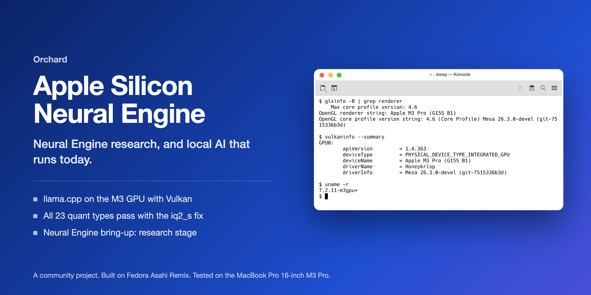
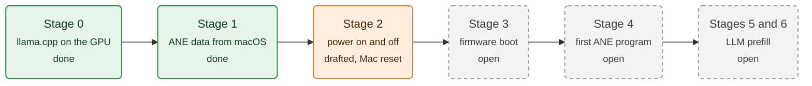

<p align="center">
  
</p>

<p align="center">
  <a href="https://github.com/zainnobody/orchard"><b>Orchard hub</b></a> ·
  <a href="#local-ai-on-the-gpu-quick-start"><b>Local AI quick start</b></a> ·
  <a href="docs/llm-baseline.md"><b>LLM results</b></a> ·
  <a href="https://github.com/zainnobody/apple-silicon-linux-kit/blob/main/GUIDE.md"><b>Guide</b></a>
</p>

<div align="center">

[](LICENSE)  

</div>

Part of [Orchard](https://github.com/zainnobody/orchard), extra drivers and fixes for Linux on Apple silicon Macs. Start with the [Apple Silicon Linux Kit guide](https://github.com/zainnobody/apple-silicon-linux-kit/blob/main/GUIDE.md).


> **Community research project.** This is not Asahi Linux code. The Asahi developers do not support it. No ANE code works yet, and an early test made the Mac reset.

Plan and work notes for the Apple Neural Engine (ANE) on Linux, with local LLMs as the goal. The first test machine is the MacBook Pro 16-inch M3 Pro (Mac15,7, J516s, SoC T6030, ANE generation H15).

Status 2026-10-26: no ANE code runs on the test machine. Stage 0 done: local LLMs run on the GPU with llama.cpp and Vulkan (Llama 3.1 8B: 150 tokens/s prompt, 22.7 tokens/s generation; the CPU makes 25.1. Before the memory floor patch: 5.8 and 6.6). See `docs/llm-baseline.md`.

Status 2026-10-27: Stage 1 data is in our macOS ADT dump (`docs/research-2026-10-27.md`). Stage 2 is drafted offline, not tested: a `t6030` ANE node, a probe-only module and a test plan (`docs/stage2-t6030-node.md`, `docs/stage2-test-plan.md`). Main finding: on T6030 the ANE has one real PMGR power domain, `ps_ane_sys`. The ADT sub-domains are virtual.

Window 2026-10-27 11:53: the probe powered `ane_sys` on and off 5 times without error, then the M3 reset (PMU boot error, no panic). Most likely cause: the PMP got no PTD request for the ANE (bit 5). Next: a PMP report entry for the ANE, then one cycle. See `docs/stage2-window-result-2026-10-27.md`.

## Test results

| Test | Result | Source |
|---|---|---|
| llama.cpp on the M3 GPU (Vulkan), Llama 3.1 8B Q4_K_M | 150 tokens/s prompt, 22.7 tokens/s generation | `docs/llm-baseline.md` |
| Same model on the CPU | 70.6 tokens/s prompt, 25.1 tokens/s generation | `docs/llm-baseline.md` |
| Same answer on GPU and CPU (temperature 0) | Same 40 tokens | `llm/stage0.sh check` |
| `test-backend-ops` MUL_MAT with the `iq2_s` fix | All 23 quant types pass | `docs/llm-baseline.md` |
| ANE power cycle probe (stage 2) | 5 cycles, then the Mac reset | `docs/stage2-window-result-2026-10-27.md` |

## Local AI on the GPU, quick start

On a GPU boot of a Mac with the kit installed. `deps` asks for the sudo password once:

```bash
llm/stage0.sh deps
```

```bash
llm/stage0.sh build
```

```bash
llm/stage0.sh models
```

```bash
llm/stage0.sh bench     # llama-bench on the GPU and the CPU
```

```bash
llm/stage0.sh check     # the same prompt must give the same text on GPU and CPU
```

## Neural Engine progress



## Findings

| Item | Result | Source |
|---|---|---|
| ANE driver in our kernel | `drivers/accel/ane` exists. It matches M1 (`t8103`, `t6000`) and M2 Pro/Max (`ane_t6021`, firmware load, "provisional"). No T6030 (M3) match. | Local clone of the SiliconForest kernel, commit 0e1f4666 |
| ANE in the M3 device tree | No `ane` node under `/proc/device-tree/soc`. No ANE option in the running kernel config. | Read on the M3, 2026-10-26 |
| Asahi upstream | The ANE on M3 is "TBA". The original driver (eiln/ane) has had no commits since 2023-11. | `docs/research-2026-10-26.md`, section 1 |
| Compiler | No open compiler. ANE programs ("hwx") come from Core ML or private compilers on macOS. | Same, section 3 |
| ANE vs GPU for LLM decode | Decode is limited by memory bandwidth. On an M4 Max, Llama 3.2 1B runs at 47-62 tok/s on the ANE and about 204 tok/s on the GPU (MLX). The ANE uses much less power. | Same, section 3 (community numbers) |
| GPU on our test machine | Works with native Mesa: OpenGL 4.6, Vulkan 1.4, 18 cores. | `agx-linux-kit` |

## Recommendation

1. Run local LLMs now on the GPU with llama.cpp and Vulkan. This path uses the native Mesa from `agx-linux-kit`. It needs no new kernel work.
2. Measure a CPU baseline with llama.cpp on the same models. This gives a fallback and a reference number.
3. Start the ANE bring-up as a separate, long project. The first useful result (one matrix multiply on the ANE) needs several months of part-time reverse engineering. For token generation, the GPU stays faster even after that.

The ANE has value for low power and for prefill of small, fixed-shape models. It does not replace the GPU for decode speed.

## Stages

| Stage | Work | Effort (estimate) | Risk | Gate to the next stage |
|---|---|---|---|---|
| 0 | llama.cpp with Vulkan on the native GPU, and a CPU baseline. Models: Llama 3.2 3B and an 8B in Q4_K_M. Record pp512 and tg128 (`llama-bench`). | 1 day | Low | Numbers in `docs/llm-baseline.md` |
| 1 | In macOS (offline, read only): dump the `ane` node of the Apple device tree (`ioreg -p IODeviceTree`). Record MMIO ranges, interrupts, power domains and DART. Locate the H15 ANE firmware file and record its hash. | 1-2 weeks | Medium | A complete node description in `docs/` |
| 2 | Write a `t6030` ANE device tree node, modeled on the T602x node. Power on through genpd only, never with raw PMGR writes. | 1-3 weeks | High: a bad register access can hang the SoC | The driver probes, powers on and off without a hang |
| 3 | Adapt the `ane_t6021` boot path to H15: firmware load, mailbox, handshake. Learn the protocol with the m1n1 hypervisor while macOS drives the ANE. | 1-3 months | Highest unknown | The ANE firmware boots and answers |
| 4 | Run one small hwx (matmul or 1x1 conv) compiled on macOS. Compare the result with the CPU. | 2-4 weeks | High | Exact result, DART mapping proven |
| 5 | Userspace: a model to hwx path that compiles offline on macOS (static shapes, FP16). | 2-4 months | High | A transformer block runs |
| 6 | LLM use: prefill on the ANE, decode on the GPU. Small models, 512-2048 context. | 1-2 months | Medium; benefit is limited | Measured gain over GPU only |

## Rules

- macOS on the test machine stays offline. Stage 1 work in macOS is read only.
- Apple firmware files stay on the machine. Do not put them in this repository or in any public place.
- Do not copy Apple code or decompiled code into anything that is published.
- The Asahi project does not accept contributions made with LLM help. This work is not an upstream contribution. Any upstream report needs a separate decision.
- Each stage that changes the kernel or the boot chain uses the same rollback as `agx-linux-kit` (stock kernel stays the default boot).

## Files

| Path | Contents |
|---|---|
| `llm/stage0.sh` | Stage 0: build llama.cpp (Vulkan and CPU-only), download two test models, run `llama-bench` on the GPU and the CPU, check that GPU and CPU text match |
| `docs/llm-baseline.md` | Stage 0 results: GPU and CPU numbers, output check, problems found |
| `docs/research-2026-10-26.md` | Research notes with sources: driver status, H15 facts, compiler problem, LLM speed data, staged plan |
| `docs/research-2026-10-27.md` | Stage 1 data from our macOS ADT dump; outside work on M3 and M4 |
| `docs/stage2-t6030-node.md` | Stage 2 data: absolute addresses, interrupts, DART, PMGR domain mapping, driver comparison, checks done, open questions |
| `docs/stage2-test-plan.md` | Stage 2 test plan with gates, steps and rollback (not run) |
| `dts/t6030-ane.dtsi` | Draft ANE node and ANE DARTs for the kernel source tree |
| `patches/` | Kernel patches: 0001 DT node, 0002 probe-only driver (`drivers/accel/ane/ane_t6030_probe.c`) |
| `probe/` | The probe-only driver as an out-of-tree module for the running kernel |
| `tools/make-ane-test-dtb.py` | Builds the stage 2 test DTB from the installed DTB; fails if any line is removed |
| `docs/stage2-window-result-2026-10-27.md` | Result of the 11:53 window: reset after the power cycles, evidence, cause, next step |
| `docs/stage2-reboot-window.md` | 15-minute reboot window runbook with exact commands (not run) |
| `docs/stage3-protocol-check.md` | H14 against H16 boot protocol comparison; verdict PARTLY |
| `patches/drafts/h15-boot-first-leg.patch` | Draft H15 first-leg boot module (CPU release, READY). Not built against a kernel; needs an m1n1 preload reservation first |
| `stage4/` | Harness and model that compile an `h15g` program on the M5 host Mac |

## License

The scripts and documents in this repository are under the GNU General Public License version 2 ([LICENSE](LICENSE)).

Some files keep another license. Their SPDX header names it:

- `dts/`, `patches/` and `probe/`: Linux kernel and device tree code. The license is GPL-2.0, and some files are dual GPL-2.0 OR MIT.
- `llm/*.patch`: llama.cpp patches, MIT like llama.cpp.
